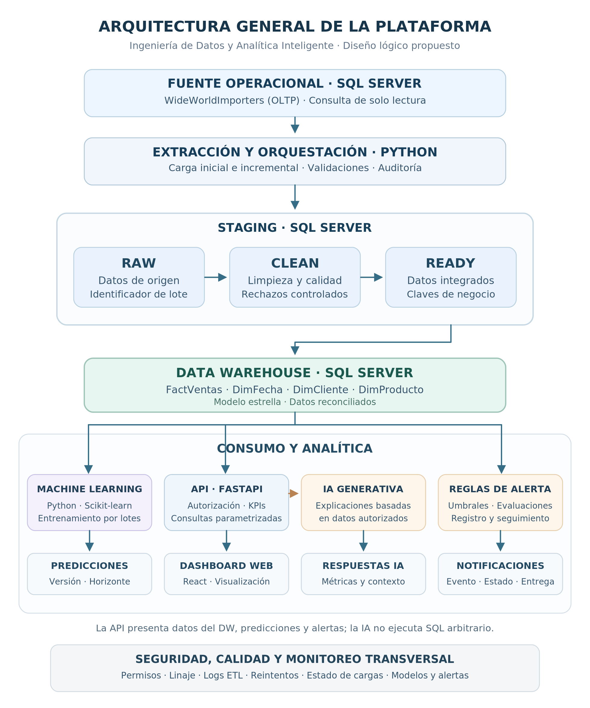
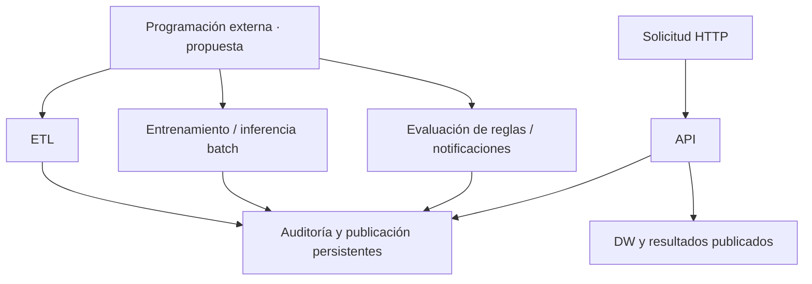

# Arquitectura de la plataforma

El diseño aprobado analiza ventas de WideWorldImporters en SQL Server 2022 Express. Los contratos están documentados; los componentes ejecutables y las validaciones del DW todavía están pendientes.

## Arquitectura general

[Fuente vectorial del diagrama](../../Figura_2_Arquitectura_Plataforma.svg). El diagrama y el capítulo de arquitectura del informe describen el mismo flujo.

SQL Server → extracción Python/SQL → Raw → Clean → Ready → DW estrella → API y componentes analíticos → dashboard y notificaciones. Seguridad, calidad, linaje y monitoreo son transversales.

## Responsabilidades y conexiones

Los módulos son límites de responsabilidad del mismo proyecto; no requieren un microservicio ni una carpeta vacía por componente.

| Módulo | Responsabilidad y contrato |
|---|---|
| Datos / SQL Server | Fuente de lectura; staging, DW y control operativo separados lógicamente |
| ETL | Proyección de cuatro entidades, validación, integración, cargas y auditoría; proceso independiente |
| Backend FastAPI | Acceso, consultas parametrizadas al DW, filtros, detalle, resultados y estado operativo |
| Frontend React/TypeScript/Vite/ECharts | Consumir HTTP; KPIs, tendencias, filtros, detalle, predicciones, chat y alertas |
| ML con Scikit-learn | Preparar variables, entrenar, evaluar e inferir desde datos del DW; resultados versionados |
| GenAI | Herramientas analíticas limitadas, contexto autorizado y explicaciones sustentadas |
| Notificaciones | Reglas aprobadas, eventos, deduplicación, reintentos, entrega y estados |
| Scripts / pruebas | Entradas de ejecución, identidad, orden, códigos de salida, recuperación y casos reproducibles |

El código se separará en etl, backend, frontend, machine-learning, generative-ai, notifications, scripts y tests al implementarlo. Las aplicaciones no dependen de notebooks ejecutados manualmente.

El navegador solo consume la API. ETL lee el original con una cuenta de lectura y escribe en el destino autorizado. API y ML consultan DW o vistas controladas; las escrituras de estado, predicciones y alertas tendrán permisos limitados a su responsabilidad.

Autenticación, puertos, nombres físicos de bases/esquemas y cuentas están pendientes. El nombre confirmado de instancia no prueba TCP, puerto fijo ni SQL Authentication habilitados. Los secretos se mantienen en configuración local excluida de Git.

## Ejecución y orquestación

ETL, entrenamiento y automatización se ejecutan fuera de las solicitudes HTTP. Si se incorpora una solicitud administrativa de ejecución, deberá delegar el trabajo y devolver un identificador; no ejecutar el lote dentro de la petición.

Se propone Programador de tareas de Windows para el entorno académico. Identidad, frecuencia, exclusión de concurrencia, reintentos y recuperación se definirán con la implementación. No hay tareas configuradas.

## Almacenamiento, calidad e incrementales

El modelo principal confirmado es FactVentas por InvoiceLineID con DimFecha, DimCliente y DimProducto. DimCliente actúa como comprador y responsable de facturación. Los atributos y períodos de sistema no se confunden con la fecha comercial.

Raw conserva lo recibido por corte; Clean aplica reglas y registra cuarentena; Ready integra entidades y resuelve grano y claves. El watermark y la publicación solo avanzan al terminar correctamente el lote.

Se propone una base analítica separada del OLTP y esquemas por zona. Los [resultados de origen](../../database/README.md#resultados-confirmados-en-sql-server) identifican catálogos temporales, archivos asociados, transaccionales no temporales y controles observados.

La estrategia de referencia realiza lectura completa y carga diferencial del destino. La optimización por timestamp requiere demostrar garantías: LastEditedWhen por sí solo no captura todos los cambios. Deben incluirse modificaciones de cabecera, registros tardíos, bajas, idempotencia y recuperación.

SQL Server 2022 Express limita cada base relacional a 10 GB, el buffer pool a 1.410 MB por instancia y el cómputo al menor valor entre un socket y cuatro núcleos. No dispone de SQL Server Agent ni CDC. Staging y DW comparten capacidad si están en la misma base. Medir espacio, lecturas, retención y duración antes de incorporar historial. [Referencia oficial](https://learn.microsoft.com/en-us/sql/sql-server/editions-and-components-of-sql-server-2022?view=sql-server-ver16)

## Contratos de consumo y operación

| Área | Requisitos que deberá demostrar |
|---|---|
| BI/API | Acceso apropiado para la demo; seis KPIs, fecha y dos dimensiones, tendencias, detalle paginado, drill-down, última actualización y estados de carga/error/sin datos. KPI contrastado con SQL independiente |
| ML | Problema, objetivo y horizonte definidos; variables reproducibles, train/validación/test temporal, baseline, métricas y límites. Modelo con parámetros/fecha/versión y predicciones con fecha/horizonte, visibles desde servicios |
| GenAI | Identidad y permisos, consultas controladas, límites de entrada/tamaño/frecuencia, privacidad y corte. Distinguir hechos, predicciones e interpretación. Diez preguntas de prueba, dos sin información suficiente |
| Alertas | Al menos un flujo completo y trazable: evento con ID/fecha, tipo/severidad, entidad/indicador, valor/umbral o predicción, período, origen, explicación/acción si aplica y estado |
| Monitoreo | Ejecuciones, última carga exitosa, leídos/rechazados, duración, errores, modelo y estados de notificación |
| Recuperación | Inicio/reinicio, reintentos, reconstrucción/restauración del laboratorio y orden de scripts reproducibles |

El caso predictivo propuesto es ventas mensuales. Hay 41 meses documentados; 228.265 líneas no equivalen a ese número de observaciones mensuales. Deben limitarse complejidad y promesas de precisión, considerar sesgos y documentar reentrenamiento.

Se propone primero notificación web. Estados candidatos: nueva, atendida, descartada y resuelta. Probar disparo/no disparo, deduplicación, fallas, reintentos, generación y entrega. Frecuencia y latencia serán medibles; una ejecución batch no se presenta como tiempo real y las simulaciones se identifican.

## Decisiones y pendientes para implementar

CONFIRMADO identifica alcance aprobado o resultados con procedencia; PROPUESTO, un diseño por aceptar; PENDIENTE, información o validación aún necesaria. Documentar un contrato no demuestra que funcione.

| Decisión / riesgo | Estado y resolución necesaria |
|---|---|
| Grano y dimensiones | CONFIRMADO el modelo principal; PENDIENTES tipos físicos, claves técnicas y rol de filtro predeterminado |
| SCD y referencias | PROPUESTO Tipo 1 inicial. Aprobar tratamiento de desconocidos/bajas y reutilización de IDs; perfilar archivos y atribución temporal antes de Tipo 2 |
| Métricas | Aprobar moneda, unidades, créditos/signos, nulos, cantidades no positivas, redondeo/rango y tolerancias; designar responsable funcional |
| Incremental | Aprobar lectura de referencia, corte consistente y checkpoints; verificar escritura/commit, precisión y zona horaria de LastEditedWhen antes de fijar solapamiento y periodicidad de reconciliación |
| Operación en Express | Medir capacidad, lotes, frecuencia y concurrencia; aprobar retención y publicación consistente. No eliminar una base Raw todavía necesaria |
| Seguridad | Elegir acceso de demo, cuentas mínimas e identidad de procesos; restringir datos enviados a servicios externos |
| ML y GenAI | Definir importe objetivo, horizonte, variables/modelo, métricas y monitoreo; elegir proveedor generativo, presupuesto, cuotas, datos autorizados y privacidad |
| Alertas | Definir regla, umbral, comparación, frecuencia, canal/destinatario y estados; el 15 % de la guía es un ejemplo, no una regla aprobada |
| Entorno y entrega | Resolver intérprete Python, versiones compatibles y manifiestos; manuales y evidencia de ejecución se completan con el código |

La fuente original y los archivos temporales permanecerán intactos. Toda mutación o reinicio de prueba se hará en un laboratorio independiente autorizado, con identidad de destino comprobada. Los totales observados y los cuatro controles sin incidencias no garantizan calidad futura ni ausencia de anomalías no medidas.

## Especificaciones de referencia

- [Modelo y diccionario dimensional](dimensional-model.md).
- [Staging y catálogo de reglas](staging-design.md).
- [Inicial/incrementales y casos aislados](incremental-loads.md).
- [Métricas y consultas propuestas](../quality/metrics-contract.md).
- [Requisitos, pruebas y entregables](../requirements/traceability.md).
