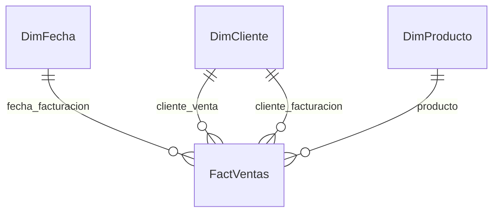

# Especificación dimensional de ventas

Versión de diseño: 0.2 · 2026-11-14 · Especificación de diseño. **CONFIRMADO** el modelo lógico principal; **PROPUESTOS** los detalles de carga y SCD. No es DDL ni acredita implementación.

## Convención y fuentes

**CONFIRMADA**: decisión aprobada o característica documentada en el origen, incluida la verificación comunicada por el usuario. **PROPUESTA**: contrato recomendado para revisión. **PENDIENTE**: información o regla que requiere confirmación. La validación del futuro DW/ETL sigue pendiente; los nuevos hechos del origen se registran expresamente sin reejecución por el agente.

Fuentes: diccionario CSV normalizado, DBML parcial, informe actualizado (tabla 4 y capítulo de arquitectura), guía, páginas 6–8, y verificaciones SQL comunicadas por el usuario. La fuente comprende cuatro entidades principales. La procedencia de los nuevos resultados está en [verificaciones de origen](../../database/README.md#resultados-confirmados-en-sql-server).

## Modelo lógico y granularidad

- **CONFIRMADA:** proceso de ventas y arquitectura en estrella.
- **CONFIRMADO como diseño principal — D-01:** `FactVentas` representa el estado vigente de una línea identificada por `Sales.InvoiceLines.InvoiceLineID`.
- **CONFIRMADO como diseño principal — D-02:** dimensiones `DimFecha`, `DimCliente` y `DimProducto`. `DimCliente` participa como comprador y responsable de facturación.
- **PROPUESTA:** nombres lógicos en este documento; bases, esquemas físicos, restricciones y DDL todavía no existen.

Una corrección actualiza la misma línea; no crea un segundo hecho con el mismo InvoiceLineID. InvoiceID es una dimensión degenerada conservada en el hecho. La publicación agrupa los cambios de las cuatro entidades y sus controles.

## Clasificación del origen de campos

- **FUENTE:** valor copiado de una columna existente, incluso si se renombra.
- **DERIVADO:** cálculo reproducible a partir de columnas existentes.
- **TÉCNICO ETL:** clave, estado o metadato generado por la plataforma; no existe como columna de negocio de WideWorldImporters.

Todas las columnas de destino siguientes son especificaciones propuestas. Las referencias de origen corresponden al CSV existente; los tipos finales de texto quedan pendientes de verificar longitudes del catálogo.

## FactVentas: contrato de atributos

| Campo lógico de destino | Clase | Origen o generación | Tipo lógico / condición propuesta |
|---|---|---|---|
| InvoiceLineID | FUENTE | `Sales.InvoiceLines.InvoiceLineID` | int; clave natural del grano, única |
| InvoiceID | FUENTE | `Sales.InvoiceLines.InvoiceID` | int; factura degenerada |
| StockItemID | FUENTE | `Sales.InvoiceLines.StockItemID` | int; linaje y filtros por clave natural |
| CustomerID | FUENTE | `Sales.Invoices.CustomerID` | int; cliente de la venta |
| BillToCustomerID | FUENTE | `Sales.Invoices.BillToCustomerID` | int; responsable de facturación de esa factura |
| InvoiceDate | FUENTE | `Sales.Invoices.InvoiceDate` | date; fecha comercial, no fecha ETL |
| IsCreditNote | FUENTE | `Sales.Invoices.IsCreditNote` | bit; conservar sin invertir signos |
| Quantity | FUENTE | `Sales.InvoiceLines.Quantity` | int; suma futura en bigint |
| UnitPrice | FUENTE | `Sales.InvoiceLines.UnitPrice` | decimal(18,2), permite NULL en el diccionario |
| TaxAmount | FUENTE | `Sales.InvoiceLines.TaxAmount` | decimal(18,2) |
| ExtendedPrice | FUENTE | `Sales.InvoiceLines.ExtendedPrice` | decimal(18,2) |
| LineProfit | FUENTE | `Sales.InvoiceLines.LineProfit` | decimal(18,2) |
| ImporteBaseLinea | DERIVADO | Quantity × UnitPrice de la línea | decimal(29,2); NULL si no puede calcularse |
| FechaKey | TÉCNICO ETL | Clave de DimFecha para InvoiceDate | int; AAAAMMDD |
| ClienteVentaKey | TÉCNICO ETL | Resolver CustomerID en DimCliente | int; clave sustituta, 0 reservado |
| ClienteFacturacionKey | TÉCNICO ETL | Resolver BillToCustomerID de la factura en DimCliente | int; mismo catálogo, otro rol |
| ProductoKey | TÉCNICO ETL | Resolver StockItemID en DimProducto | int; clave sustituta, 0 reservado |
| EsEliminadoFuente | TÉCNICO ETL | Ausencia confirmada en un corte completo | bit; marca técnica, no estado OLTP |
| execution_id / publication_id | TÉCNICO ETL | Lote que produjo la última versión publicada | Identificadores definidos en staging |

**PROPUESTA — D-03:** InvoiceLineID identifica el hecho; no añadir otra clave sustituta al hecho sin necesidad concreta. Las dimensiones sí utilizan claves sustitutas. Las claves naturales conservadas no reemplazan sus relaciones dimensionales.

El origen del importe base es el precio de la línea; `Warehouse.StockItems.UnitPrice` es otro valor documentado del catálogo y no sustituye al histórico de la venta.

## DimFecha

| Campo propuesto | Clase | Regla |
|---|---|---|
| FechaKey | TÉCNICO ETL | Año × 10000 + mes × 100 + día |
| Fecha | DERIVADO / calendario | Fecha natural única del calendario |
| Anio / Mes / Dia / Trimestre | DERIVADO | Componentes de Fecha |
| DiaSemanaISO | DERIVADO | Lunes = 1 a domingo = 7, independiente del idioma y DATEFIRST |
| EsFinDeSemana | DERIVADO | DiaSemanaISO en 6 o 7 |

**PROPUESTA — D-04:** generar días completos de los años cubiertos por las fechas elegibles y extenderlos según nuevos datos o un horizonte aprobado. Enero de 2013 a diciembre de 2016 sería el calendario del descubrimiento, pero la cobertura de ventas termina en mayo de 2016.

Una fecha de calendario sin cobertura del origen no demuestra ventas cero. La API deberá distinguir ausencia de cobertura de un período cubierto sin operaciones. Año 2016 completo no se comparará como si tuviera doce meses de ventas.

Clave natural: Fecha. Clave técnica: FechaKey. Reservar 0 para el miembro técnico desconocido, con fecha y componentes NULL. Una InvoiceDate obligatoria ausente o inválida es error crítico: no se repara automáticamente con la fecha desconocida.

## DimCliente

| Campo propuesto | Clase | Origen o regla |
|---|---|---|
| ClienteKey | TÉCNICO ETL | Entero estable por CustomerID; 0 desconocido |
| CustomerID | FUENTE | `Sales.Customers.CustomerID`; clave natural |
| CustomerName | FUENTE | `Sales.Customers.CustomerName` |
| BillToCustomerIDActual | FUENTE, alias | `Sales.Customers.BillToCustomerID`; relación actual del catálogo |
| EsEliminadoFuente | TÉCNICO ETL | Ausencia confirmada del cliente en el corte completo |
| execution_id / publication_id | TÉCNICO ETL | Procedencia de la actualización |

**PROPUESTA — D-05:** una sola fila por cliente natural, SCD Tipo 1. Un cambio de nombre o relación actual modifica atributos y conserva ClienteKey. El espacio de claves se identifica por sistema de origen y CustomerID; no se asume que el ID natural de origen sea positivo o que 0 esté libre.

### CustomerID y BillToCustomerID

- `Sales.Invoices.CustomerID` determina ClienteVentaKey.
- `Sales.Invoices.BillToCustomerID` determina ClienteFacturacionKey.
- `Sales.Customers.BillToCustomerID` describe una autorreferencia del catálogo actual; no sustituye el responsable almacenado en una factura anterior.

Una factura tiene un cliente de venta y uno de facturación, que pueden coincidir. Ambos roles consultan DimCliente con alias distintos; no duplican filas del hecho. Un cambio solo en la autorreferencia del catálogo no reescribe el BillToCustomerID de facturas existentes.

## DimProducto

| Campo propuesto | Clase | Origen o regla |
|---|---|---|
| ProductoKey | TÉCNICO ETL | Entero estable por StockItemID; 0 desconocido |
| StockItemID | FUENTE | `Warehouse.StockItems.StockItemID`; clave natural |
| StockItemName | FUENTE | `Warehouse.StockItems.StockItemName` |
| Brand | FUENTE | `Warehouse.StockItems.Brand`; conservar NULL permitido |
| EsEliminadoFuente | TÉCNICO ETL | Ausencia confirmada en corte completo |
| execution_id / publication_id | TÉCNICO ETL | Procedencia de la actualización |

**PROPUESTA — D-06:** SCD Tipo 1. No agregar categoría, proveedor, ciudad, región ni empleado sin incorporar y validar sus fuentes. Brand es atributo del producto; no requiere otra dimensión inicialmente.

## Historización y claves estables

**PROPUESTA — D-07:** SCD Tipo 1 para clientes y productos en la primera versión. Permite reconciliar el estado actual sin afirmar que los atributos disponibles hoy describían una venta de 2013. Los informes agruparán ventas históricas por los atributos de catálogo observados actualmente, con esta limitación visible.

**CONFIRMADO por las verificaciones del usuario:** Sales.Customers y Warehouse.StockItems son SYSTEM_VERSIONED_TEMPORAL_TABLE, con Sales.Customers_Archive y Warehouse.StockItems_Archive como archivos asociados. Sales.Invoices y Sales.InvoiceLines son NON_TEMPORAL_TABLE. La existencia de esos objetos ya no está pendiente.

### Evaluación del historial temporal para SCD

| Alternativa | Aprovechamiento del historial confirmado | Evaluación |
|---|---|---|
| Tipo 1 inicial | Perfilar cambios y auditar diferencias entre versiones; conservar una fila actual por clave natural | PROPUESTO para la primera versión: mantiene las métricas y claves simples; no responde «cómo era el atributo al vender» |
| Tipo 2 por vigencia del sistema | Conservar versiones de los archivos y resolver un instante de sistema explícito | PROPUESTO como ampliación condicionada a cobertura, calidad de intervalos y regla temporal aprobada |
| Tipo 2 por fecha comercial | Atribuir la versión que regía comercialmente en cada venta | PENDIENTE: InvoiceDate no acredita por sí sola un instante de negocio ni su relación con el período del sistema |

Se distinguen tres tiempos: InvoiceDate (fecha comercial), período de sistema del catálogo y extracted_at_utc/publication_id (observación y carga). El período de sistema refleja cambios del motor y no la fecha comercial de una venta. Una fecha sin hora tampoco resuelve cambios de catálogo ocurridos dentro del mismo día. [Semántica temporal de SQL Server](https://learn.microsoft.com/en-us/sql/relational-databases/tables/temporal-tables?view=sql-server-ver16)

**PROPUESTO:** antes de aprovechar los archivos, perfilar versiones por clave, cobertura, retención, intervalos, posibles versiones repetidas/de duración cero y correspondencia de columnas del período. Después contrastar el estado actual con versiones seleccionadas mediante un instante de sistema explícito. No unir todas las versiones a FactVentas: multiplicaría líneas e importes.

La primera estrella mantiene Tipo 1 propuesto porque aún no existe una regla aprobada de atribución histórica de negocio. La disponibilidad del historial permite evaluar Tipo 2 con evidencia; no obliga a inventar esa regla ni a descartar el historial. No se fabricarán versiones anteriores a la cobertura demostrada.

ValidFrom y ValidTo se conservan en Raw. Su correspondencia de período se verificará al preparar la extracción autorizada; no se renombran automáticamente como períodos SCD del DW. La lectura de archivos sería auxiliar de las dos entidades, sin incorporar nuevas dimensiones de negocio. La cobertura y la interpretación histórica siguen **PENDIENTES**.

Las claves sustitutas se asignan y persisten una sola vez. Reintentos y cambios Tipo 1 conservan la clave. Reiniciar una carga no debe regenerar arbitrariamente claves de dimensiones ya publicadas.

## Dimensiones desconocidas y bajas

**PROPUESTA — D-08:**

- Crear un miembro técnico con clave sustituta 0 en cada dimensión. Sus claves naturales son NULL, no IDs inventados del origen.
- Cliente o producto con ID natural presente pero catálogo no resuelto: conservar ID, asignar temporalmente 0, registrar incidencia y mantener importes. La aceptación de esta política está pendiente.
- InvoiceLineID, InvoiceID de cabecera o InvoiceDate ausentes/incorrectos: cuarentena crítica y bloqueo de publicación. No asignar una factura o fecha ficticia.
- Al resolver un catálogo tardío, corregir las claves técnicas del mismo hecho sin duplicarlo ni modificar sus importes.
- Una Brand NULL en un producto conocido no convierte al producto en desconocido.

**PROPUESTA — D-09:** bajas por ausencia solo tras verificar un snapshot completo. Mantener hechos y dimensiones con EsEliminadoFuente técnico. Los KPIs estándar incluyen hechos con EsEliminadoFuente = 0. No generar importes negativos para simular devoluciones ni borrar físicamente historia de auditoría.

Las dimensiones dadas de baja conservan sus claves y atributos para referencias existentes. Filtrar un catálogo por activo no debe eliminar ventas por accidente. Reactivar el mismo ID requiere comprobar su identidad; la posible reutilización de claves naturales es una decisión pendiente.

## Medidas y otras dimensiones

| Medida | Clasificación propuesta | Agregación |
|---|---|---|
| Quantity | Aditiva sobre líneas elegibles | Suma en bigint |
| ImporteBaseLinea, ExtendedPrice, TaxAmount, LineProfit | Aditivas si la unidad monetaria es homogénea | Suma decimal; tratamiento de faltantes según contrato |
| UnitPrice | No aditiva | Atributo de la línea; no sumar precios |
| Facturas distintas | No aditiva entre grupos que comparten facturas | Recalcular COUNT DISTINCT de InvoiceID |
| Margen de utilidad | No aditiva | Cociente de sumas; no sumar ni promediar márgenes de líneas |

No hay un saldo semiaditivo identificado en las cuatro tablas del alcance. El concepto puede explicarse con un saldo de inventario, sin añadirlo al modelo de ventas.

InvoiceID permanece degenerado. IsCreditNote se conserva como indicador; no necesita dimensión propia. Empleado, geografía y categorías requieren ampliar fuentes y no se proponen para la primera estrella.

## Criterios de aceptación futuros

1. Una fila total y una fila activa como máximo por InvoiceLineID.
2. Una fila dimensional por clave natural en SCD Tipo 1, con claves estables.
3. Todas las referencias técnicas resueltas o asignadas a 0 con incidencia explícita.
4. Dos roles de cliente correctos y prueba de cambio exclusivo de responsable de facturación.
5. Conteos e importes reconciliados por línea, fecha, cliente y producto.
6. Cantidades, precios, impuestos e importes conservan signos y precisión; nulos no se transforman en cero.
7. Cambios y bajas no multiplican hechos; reejecución idempotente.
8. Consultas del [contrato de métricas](../quality/metrics-contract.md) ejecutadas únicamente en una fase autorizada.

Referencias: [staging](staging-design.md), [incrementales](incremental-loads.md), [decisiones pendientes](architecture.md#decisiones-y-pendientes-para-implementar). Toda validación funcional sigue **PENDIENTE**.
